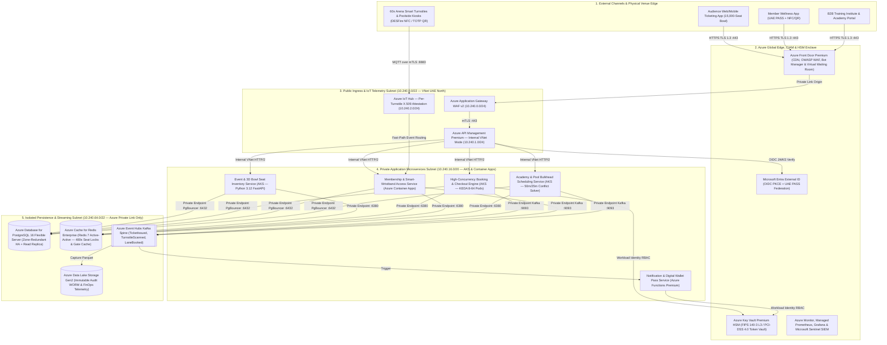
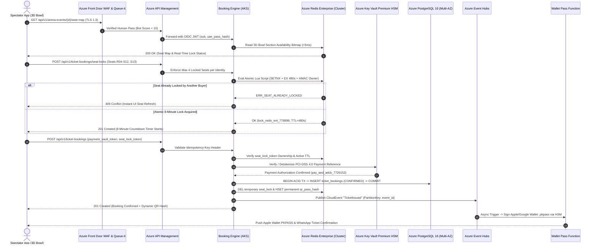
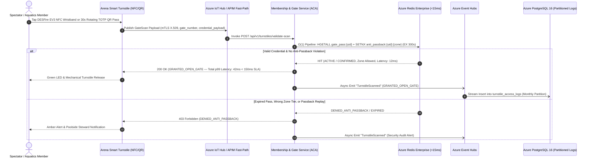
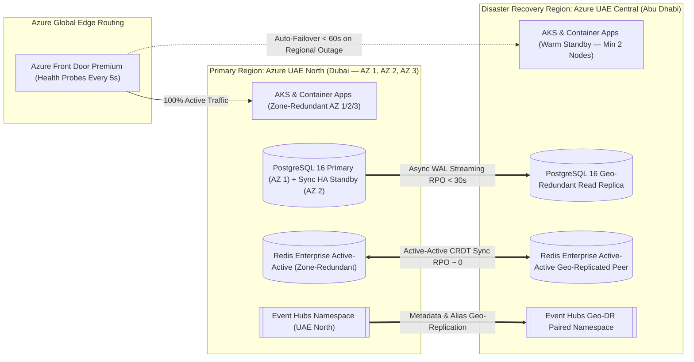

# High-Level Design (HLD) — Hamdan Sports Complex Unified Arena & Academy Platform

## 1. Executive Summary & Architectural Vision
This **Architecture Review Board (ARB) High-Level Design** specifies the production-grade, Zone-Redundant (`AZ 1, 2, 3`) cloud architecture for **Hamdan Sports Complex Unified Arena & Academy Platform** deployed in **azure** with warm-standby disaster recovery in **Azure UAE Central (Abu Dhabi)**.
The platform is engineered for **High Availability (99.99%) & Zero-Trust Security** under **25,000 RPS Peak • Multi-AZ Auto-Scaling**, enforcing **SOC 2 Type II, ISO 27001, PCI-DSS 4.0, and UAE PDPL** across all ingress, compute, streaming, and data persistence tiers.

| Architectural Dimension | Standardized Specification | Target SLA / Governance Baseline |
| :--- | :--- | :--- |
| **Primary & DR Cloud Regions** | `azure` (Primary Multi-AZ) → `Azure UAE Central` (Geo-DR) | **99.99% Availability** (`RTO: 15m`, `RPO: 0 / <1m`) |
| **Approved Application & Data Stack** | `Next.js 15 (TypeScript), Tailwind CSS, Python 3.12, FastAPI, SQLAlchemy 2.0 + Alembic, OAuth 2.0 PKCE / OIDC (Entra ID / Cognito), GitHub Actions + OpenAPI 3.1 Linter + Terraform, PostgreSQL 16 (Multi-AZ), Redis 7 Cluster` | Zero-Trust OIDC Workload Identity + Async I/O |
| **Architecture Style** | `microservices` | Strict Bounded Contexts + Private Link Persistence |
| **Peak Traffic & Turnstile Latency** | `25,000 RPS Peak • Multi-AZ Auto-Scaling` | **p99 < 150ms** Smart Turnstile NFC/QR Validation |
| **Compliance & Cryptographic Posture** | `SOC 2 Type II, ISO 27001, PCI-DSS 4.0, UAE PDPL` | FIPS 140-3 Level 3 HSM (`Azure Key Vault Premium`) |

---

## 2. Logical & Network Trust-Zone Topology (Mermaid)

---

## 3. Core Microservices, Bounded Contexts & Data Ownership Matrix

| Microservice / Component | Compute Runtime | Bounded Context & Core Responsibility | Owned ERD Tables / Backing Stores | Auto-Scaling & Resilience Policy |
| :--- | :--- | :--- | :--- | :--- |
| **Event & 3D Bowl Seat Inventory Service** | Azure Kubernetes Service (AKS) | Manages arena zones, 50m/25m movable pool bulkhead modes, championship events, and 3D seat bitmaps | `venues_and_zones`, `arena_events`, Redis `seat_bitmap:*` | KEDA HPA (`4–32 Pods` on APIM RPS + CPU 65%) |
| **High-Concurrency Booking & Checkout Engine** | Azure Kubernetes Service (AKS) | Acquires atomic 8-minute (480s) Redis seat locks, orchestrates PCI-DSS 4.0 tokenized checkout, commits ACID orders | `ticket_bookings`, Redis `seat_lock:*`, Event Hubs `TicketIssued` | KEDA HPA (`8–64 Pods` pre-scaled for 25,000 RPS ticket drops) |
| **Membership & Smart-Wristband Access Service** | Azure Container Apps (ACA) | Sub-150ms NFC wristband & rotating TOTP QR turnstile validation, UAE PASS member profiles, anti-passback | `memberships`, `turnstile_access_logs`, Redis `gate_pass:*` | Min `4 warm replicas` (`max 24`), scales on IoT Hub & APIM concurrency |
| **Academy & Pool Bulkhead Scheduling Service** | Azure Kubernetes Service (AKS) | B2B sports academy onboarding, 50m/25m lane & 10m diving well allocation, arena event conflict detection, split-invoicing | `training_institutes`, `academy_lane_allocations` | KEDA HPA (`2–12 Pods`), PostgreSQL Row-Level Security (RLS) by `institute_id` |
| **Notification & Digital Wallet Pass Service** | Azure Functions (EP2 Premium) | Signs Apple Wallet (`.pkpass`) & Google Wallet passes via HSM certificate; dispatches WhatsApp/SMS alerts | Consumes `TicketIssued`, `LaneBooked` from Azure Event Hubs | Event-driven scale (`1–20 instances`) on Event Hubs consumer lag |

---

## 4. Critical Runtime Sequence Diagrams (Mermaid)

### 4.1 High-Concurrency Ticket Drop, Atomic 8-Minute Redis Seat Lock & PCI-DSS 4.0 Checkout

### 4.2 Sub-150ms Smart Turnstile NFC Wristband & Rotating QR Gate Validation

---

## 5. Azure VNet CIDR Plan, Subnet Micro-Segmentation & Private Link Matrix

The platform is deployed inside a hub-and-spoke virtual network in **Azure UAE North (`vnet-hsc-prod-uaenorth-01`, CIDR `10.240.0.0/16`)** with zero public IP addresses on application or persistence resources.

| Subnet Name | CIDR Block | Hosted Azure Resources | NSG / Route Table Policy | Private Link / Service Endpoint |
| :--- | :--- | :--- | :--- | :--- |
| **`snet-ingress-appgw`** | `10.240.0.0/24` | Azure Application Gateway WAF v2 | Allow `:443` from `AzureFrontDoor.Backend` Service Tag only | Front Door Private Link Origin |
| **`snet-ingress-apim`** | `10.240.1.0/24` | Azure API Management (Premium, Multi-AZ) | Allow `:443` from `snet-ingress-appgw`; Egress to `snet-aks-workloads` & `snet-aca` | Internal VNet Injection |
| **`snet-iot-ingress`** | `10.240.2.0/24` | Azure IoT Hub Private Endpoint | Allow `:8883` (MQTT mTLS) from Arena Turnstile ExpressRoute / VPN Gateway | `privatelink.azure-devices.net` |
| **`snet-aks-workloads`** | `10.240.16.0/20` | AKS User Node Pools (`Event`, `Booking`, `Academy` Services) | Calico CNI NetworkPolicy; Allow ingress from `snet-ingress-apim` only | Outbound via Azure NAT Gateway |
| **`snet-aca-turnstile`** | `10.240.32.0/21` | Azure Container Apps Environment (`Membership & Gate Service`) | Allow ingress from `snet-ingress-apim` & `snet-iot-ingress` | Internal Load Balancer (ILB) |
| **`snet-privatelink-data`** | `10.240.64.0/22` | Private Endpoints for PostgreSQL 16, Redis Enterprise, Event Hubs, Key Vault HSM, ADLS Gen2 | Deny all Internet ingress/egress (`publicNetworkAccess: Disabled`) | `privatelink.postgres.database.azure.com`, `privatelink.redisenterprise.cache.azure.net`, `privatelink.vaultcore.azure.net` |

---

## 6. Event-Driven Messaging Spine (`Azure Event Hubs` Topic & Partitioning Contract)

| Event Hub Topic | Producer Service | Partition Key | Partitions / Retention | Consumer Groups | Failure & Dead-Letter Policy |
| :--- | :--- | :---: | :---: | :--- | :--- |
| **`evh-ticket-issued`** | `Booking & Checkout Engine (AKS)` | `event_id` | `16 Partitions` / `7 Days` | `cg-wallet-pass-fn`, `cg-adls-analytics`, `cg-erp-finance` | Exponential backoff (5 retries) → `sbq-ticket-issued-dlq` in Azure Service Bus |
| **`evh-turnstile-scanned`** | `Membership & Gate Service (ACA)` | `zone_id` | `32 Partitions` / `7 Days` | `cg-postgres-audit-writer`, `cg-live-crowd-telemetry`, `cg-sentinel-siem` | At-least-once idempotent upsert on `scan_id` + Event Hubs Capture to ADLS Gen2 |
| **`evh-lane-booked`** | `Academy & Bulkhead Scheduler (AKS)` | `institute_id` | `8 Partitions` / `14 Days` | `cg-b2b-invoicing`, `cg-coach-notification-fn`, `cg-pool-ops-dashboard` | Dead-letter to `sbq-lane-booked-dlq` with alert to Venue Operations |
| **`evh-bulkhead-mode`** | `Academy & Bulkhead Scheduler (AKS)` | `zone_id` | `4 Partitions` / `30 Days` | `cg-seat-inventory-cache-invalidator`, `cg-poolside-kiosk-sync` | Compaction enabled; broadcasts active `50m_10_lanes` vs `25m_20_lanes` state |

---

## 7. Multi-AZ High Availability & Cross-Region Disaster Recovery (`UAE North` ↔ `UAE Central`)

| Tier / Stateful Engine | Intra-Region HA (`Azure UAE North` AZ 1/2/3) | Cross-Region DR (`Azure UAE Central` Abu Dhabi) | Target RTO | Target RPO |
| :--- | :--- | :--- | :---: | :---: |
| **Ingress & Edge (`Front Door` + `APIM`)** | Anycast Global Edge + Multi-AZ APIM Premium units across AZ 1, 2, 3 | Automatic origin failover via Front Door health probes + multi-region APIM gateway | **< 2 mins** | **0 (Stateless)** |
| **Compute (`AKS` + `Container Apps`)** | Topology spread constraints across AZ 1, 2, 3 + PodDisruptionBudgets (`minAvailable: 75%`) | Warm-standby AKS cluster in `uaecentral` scaled via GitOps (Flux/Terraform) & ACR Geo-Replication | **< 10 mins** | **0 (Stateless)** |
| **Relational DB (`Azure PostgreSQL 16`)** | Zone-Redundant Synchronous Standby (`same-zone PgBouncer` + `60s auto-failover`) | Geo-Redundant Asynchronous Read Replica in `uaecentral` with promoted virtual endpoint | **< 15 mins** | **< 30 seconds** |
| **Seat Lock & Gate Cache (`Redis Enterprise`)** | Zone-Redundant Active-Active shards across AZ 1, 2, 3 (`99.999% SLA`) | Active-Active Geo-Distributed Redis Enterprise link between `uaenorth` and `uaecentral` | **< 1 min** | **Near-Zero (CRDT)** |

---

## 8. Key Architecture Decision Records (ADR Summary) & Observability SLOs

| ADR ID | Architectural Decision | Chosen Pattern | Rejected Alternative | Technical & Financial Rationale |
| :--- | :--- | :--- | :--- | :--- |
| **ADR-01** | **8-Minute Distributed Seat-Lock Mechanism** | **Azure Cache for Redis Enterprise Atomic Lua (`SETNX` + `EX 480`)** | PostgreSQL `SELECT ... FOR UPDATE` or Pessimistic Row Locks | At `25,000 RPS` during a 15,000-seat championship drop, relational row locking saturates PostgreSQL connection pools; Redis Lua executes in `<2ms` at `100,000+ ops/sec` with automatic kernel-level TTL eviction. |
| **ADR-02** | **Smart Turnstile Compute Isolation** | **Azure Container Apps (`Membership & Gate Service`) decoupled from AKS** | Co-locating Turnstile API on the same AKS node pool as Public Ticket Drops | Isolates physical stadium gate entry (`<150ms p99 SLA`) from internet ticket-drop burst noise so a `25,000 RPS` concert on-sale can never starve physical turnstile CPU/network threads. |
| **ADR-03** | **PCI-DSS 4.0 Cardholder Vaulting** | **Zero-PAN Tokenization via Azure Key Vault Premium HSM (`FIPS 140-3 L3`)** | Storing encrypted PAN columns inside `ticket_bookings` PostgreSQL table | Removes the core PostgreSQL database and AKS analytics read replicas from PCI-DSS Cardholder Data Environment (CDE) raw-PAN scope, reducing annual audit surface by >70%. |
| **ADR-04** | **Pool Bulkhead & Arena Event Conflict Resolution** | **ACID Exclusion Check in PostgreSQL + Redis Mode Broadcast** | Eventual-consistency async conflict detection | Prevents costly B2B double-booking when switching the main pool between `50m_10_lanes_championship` and `25m_dual_short_course_20_lanes`. |